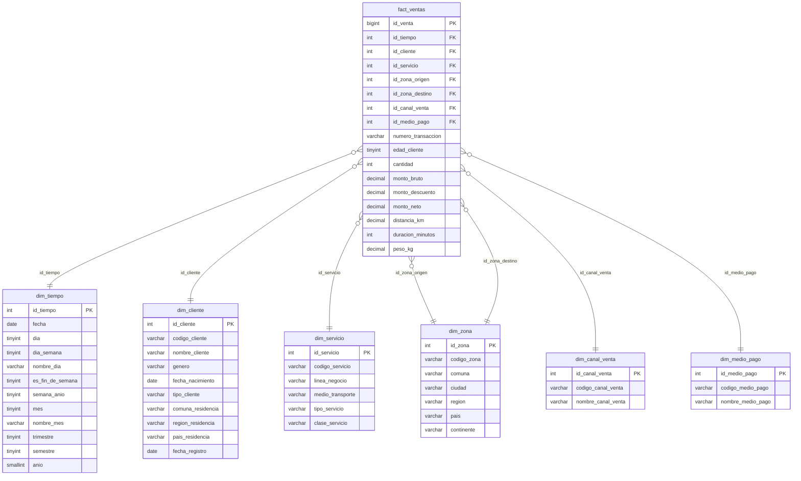

# Modelo Dimensional — Transportes Rapiditos S.A.

Fuente de verdad del diseño. Cualquier cambio al modelo se hace primero aquí y después en `sql/`.
Estado: **propuesta consolidada para el Avance N°1** (diseñada en el chat del Project; pendiente de confirmación final del grupo).

## 1. Proceso de negocio

Compras de servicios realizadas por los clientes en las seis líneas de negocio: Buses InterUrbanos Rapiditos, Trenes Rapiditos, Radio Taxis Rapiditos, Logística y Distribución Rapiditos, Aerolíneas Rapiditos y URapid Delivery.

Objetivo del enunciado: determinar qué tipos de clientes tiene la compañía y su comportamiento anual en los últimos 3 años (compra, medios de transporte, zona, edad, entre otras variables).

## 2. Grano

**Una fila por cada transacción de compra de un cliente por un servicio de una línea de negocio, en una fecha.**
Ejemplos de transacción: un pasaje de bus, tren o avión; un viaje de taxi; un envío de logística; un pedido de delivery.

## 3. Alternativas evaluadas

| Criterio | A. Hechos por transacción (elegida) | B. Snapshot mensual cliente-línea | C. Constelación (un hecho por línea) |
|---|---|---|---|
| Ajuste al enunciado (estrella, vista única del cliente) | Alto | Alto | Bajo: deja de ser una estrella única |
| Análisis por compra, medio de transporte, zona y edad | Completo | Parcial: pierde origen, destino y canal | Completo pero repartido |
| Simplicidad de ETL y script | Media | Alta | Baja |
| Riesgo en la rúbrica | Bajo | Pierde medidas | Medio |

## 4. Dimensiones

### dim_tiempo
Jerarquía: fecha → mes → trimestre → semestre → año. La PK no es autoincremental: usa formato AAAAMMDD.

| Columna | Tipo | Restricción | Descripción |
|---|---|---|---|
| id_tiempo | INT UNSIGNED | PK | Fecha en formato AAAAMMDD (ej. 20250314) |
| fecha | DATE | NOT NULL, UNIQUE | Fecha calendario |
| dia | TINYINT UNSIGNED | NOT NULL | Día del mes (1-31) |
| dia_semana | TINYINT UNSIGNED | NOT NULL | 1 = lunes … 7 = domingo |
| nombre_dia | VARCHAR(10) | NOT NULL | Lunes … Domingo |
| es_fin_de_semana | TINYINT(1) | NOT NULL | 1 si es sábado o domingo |
| semana_anio | TINYINT UNSIGNED | NOT NULL | Semana ISO del año |
| mes | TINYINT UNSIGNED | NOT NULL | 1-12 |
| nombre_mes | VARCHAR(10) | NOT NULL | Enero … Diciembre |
| trimestre | TINYINT UNSIGNED | NOT NULL | 1-4 |
| semestre | TINYINT UNSIGNED | NOT NULL | 1-2 |
| anio | SMALLINT UNSIGNED | NOT NULL | Año |

### dim_cliente
Vista única del cliente: la llave natural unifica al cliente entre todas las líneas de negocio.

| Columna | Tipo | Restricción | Descripción |
|---|---|---|---|
| id_cliente | INT UNSIGNED | PK, AUTO_INCREMENT | Llave sustituta |
| codigo_cliente | VARCHAR(20) | NOT NULL, UNIQUE | Llave natural (RUT o documento, unificado entre líneas) |
| nombre_cliente | VARCHAR(100) | NOT NULL | Nombre o razón social |
| genero | VARCHAR(20) | NULL | Género declarado (NULL para empresas) |
| fecha_nacimiento | DATE | NULL | NULL para empresas |
| tipo_cliente | VARCHAR(20) | NOT NULL | 'persona' o 'empresa' |
| comuna_residencia | VARCHAR(60) | NULL | |
| region_residencia | VARCHAR(60) | NULL | |
| pais_residencia | VARCHAR(60) | NOT NULL | |
| fecha_registro | DATE | NULL | Fecha de alta como cliente |

### dim_servicio
Línea de negocio y medio de transporte en una sola tabla (aplanado para mantener la estrella).

| Columna | Tipo | Restricción | Descripción |
|---|---|---|---|
| id_servicio | INT UNSIGNED | PK, AUTO_INCREMENT | Llave sustituta |
| codigo_servicio | VARCHAR(20) | NOT NULL, UNIQUE | Llave natural |
| linea_negocio | VARCHAR(50) | NOT NULL | Una de las 6 líneas del enunciado |
| medio_transporte | VARCHAR(30) | NOT NULL | bus, tren, taxi, camión, avión, moto/bicicleta |
| tipo_servicio | VARCHAR(20) | NOT NULL | 'pasajeros' o 'carga' |
| clase_servicio | VARCHAR(30) | NOT NULL | ej. económica, ejecutiva, express, estándar |

### dim_zona
Dimensión de rol doble (role-playing): se usa como origen y como destino. La empresa es internacional, por eso incluye país y continente.
Jerarquía: comuna → ciudad → región → país → continente.

| Columna | Tipo | Restricción | Descripción |
|---|---|---|---|
| id_zona | INT UNSIGNED | PK, AUTO_INCREMENT | Llave sustituta |
| codigo_zona | VARCHAR(20) | NOT NULL, UNIQUE | Llave natural |
| comuna | VARCHAR(60) | NOT NULL | |
| ciudad | VARCHAR(60) | NOT NULL | |
| region | VARCHAR(60) | NOT NULL | |
| pais | VARCHAR(60) | NOT NULL | |
| continente | VARCHAR(30) | NOT NULL | |

### dim_canal_venta

| Columna | Tipo | Restricción | Descripción |
|---|---|---|---|
| id_canal_venta | INT UNSIGNED | PK, AUTO_INCREMENT | Llave sustituta |
| codigo_canal_venta | VARCHAR(20) | NOT NULL, UNIQUE | Llave natural |
| nombre_canal_venta | VARCHAR(40) | NOT NULL | app, web, boletería, call center, convenio empresa |

### dim_medio_pago

| Columna | Tipo | Restricción | Descripción |
|---|---|---|---|
| id_medio_pago | INT UNSIGNED | PK, AUTO_INCREMENT | Llave sustituta |
| codigo_medio_pago | VARCHAR(20) | NOT NULL, UNIQUE | Llave natural |
| nombre_medio_pago | VARCHAR(40) | NOT NULL | efectivo, débito, crédito, transferencia, billetera digital |

## 5. Tabla de hechos: fact_ventas

| Columna | Tipo | Restricción | Tipo de medida / rol |
|---|---|---|---|
| id_venta | BIGINT UNSIGNED | PK, AUTO_INCREMENT | Llave sustituta |
| id_tiempo | INT UNSIGNED | NOT NULL, FK → dim_tiempo | |
| id_cliente | INT UNSIGNED | NOT NULL, FK → dim_cliente | |
| id_servicio | INT UNSIGNED | NOT NULL, FK → dim_servicio | |
| id_zona_origen | INT UNSIGNED | NOT NULL, FK → dim_zona | Rol origen |
| id_zona_destino | INT UNSIGNED | NOT NULL, FK → dim_zona | Rol destino |
| id_canal_venta | INT UNSIGNED | NOT NULL, FK → dim_canal_venta | |
| id_medio_pago | INT UNSIGNED | NOT NULL, FK → dim_medio_pago | |
| numero_transaccion | VARCHAR(30) | NOT NULL, UNIQUE | Dimensión degenerada (id del sistema de origen, prefijado por línea) |
| edad_cliente | TINYINT UNSIGNED | NULL | Edad al momento de la compra (no aditiva; NULL para empresas) |
| cantidad | INT UNSIGNED | NOT NULL, DEFAULT 1 | Aditiva (pasajes, bultos, unidades) |
| monto_bruto | DECIMAL(12,2) | NOT NULL | Aditiva |
| monto_descuento | DECIMAL(12,2) | NOT NULL, DEFAULT 0 | Aditiva |
| monto_neto | DECIMAL(12,2) | NOT NULL | Aditiva |
| distancia_km | DECIMAL(10,2) | NULL | Aditiva |
| duracion_minutos | INT UNSIGNED | NULL | Aditiva |
| peso_kg | DECIMAL(10,2) | NULL | Aditiva (solo logística y delivery; NULL en pasajeros) |

Supuesto: montos en pesos chilenos (CLP).

## 6. Cálculos y KPI derivados

| KPI | Cálculo |
|---|---|
| Ventas netas | SUM(monto_neto) |
| Ticket promedio | SUM(monto_neto) / COUNT(id_venta) |
| Clientes activos por año | COUNT(DISTINCT id_cliente) por anio |
| Frecuencia de compra | COUNT(id_venta) / COUNT(DISTINCT id_cliente) |
| Gasto anual por cliente | SUM(monto_neto) / COUNT(DISTINCT id_cliente) por anio |
| Participación por línea | SUM(monto_neto) de la línea / SUM(monto_neto) total |
| Clientes multilínea | Clientes con COUNT(DISTINCT linea_negocio) > 1 por año |
| Tasa de descuento | SUM(monto_descuento) / SUM(monto_bruto) |

## 7. Norma de nomenclatura

- Prefijos `fact_` para hechos y `dim_` para dimensiones.
- Nombres en singular, `snake_case` y minúsculas en todas las tablas y columnas.
- PK: `id_<entidad>`. Llave natural: `codigo_<entidad>`.
- FK: mismo nombre que la PK referenciada; en dimensiones de rol se agrega sufijo (`id_zona_origen`, `id_zona_destino`).
- Restricciones: `pk_<tabla>`, `fk_<tabla>_<columna>`, `uq_<tabla>_<columna>`.

## 8. Diagrama

## 9. Decisiones pendientes del grupo

- Perfil de usuario de la reportería: propuesta **táctico (gerencia comercial/marketing)**. Alternativa: ejecutivo.
- Formato del informe: Word o LaTeX con plantilla UTEM.
- Fuente de datos para poblar el DWH (Fase 2): datasets públicos, datos sintéticos generados con Python, o una combinación (el enunciado permite datasets públicos de la web).
