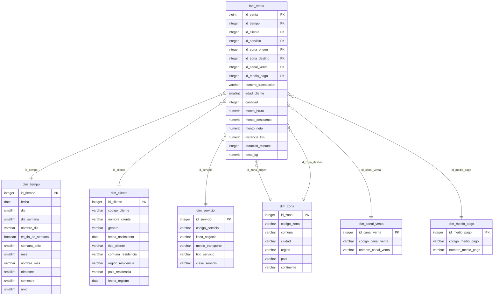

# Modelo Dimensional — Transportes Rapiditos S.A.

Fuente de verdad del diseño. Cualquier cambio al modelo se hace primero aquí y después en `sql/`.
Estado: **aprobado para el Avance N°1** (02-11-2026). Cambio respecto de la propuesta original: la tabla de hechos se renombró de `fact_ventas` a `fact_venta` para cumplir la regla de nombres en singular.

Migración a PostgreSQL 17 (04-11-2026): el proceso de negocio, el grano, las dimensiones y las medidas no cambian. Cambian los tipos de datos, que PostgreSQL no tiene sin signo, y se agregan restricciones `CHECK`, índices y nombres para las PK. El detalle está en la sección 8 y en `docs/bitacora.md`.

## 1. Proceso de negocio

Compras de servicios realizadas por los clientes en las seis líneas de negocio: Buses InterUrbanos Rapiditos, Trenes Rapiditos, Radio Taxis Rapiditos, Logística y Distribución Rapiditos, Aerolíneas Rapiditos y URapid Delivery.

Objetivo del enunciado: determinar qué tipos de clientes tiene la compañía y su comportamiento anual en los últimos 3 años (compra, medios de transporte, zona, edad, entre otras variables).

## 2. Grano

**Una fila por cada transacción de compra de un cliente por un servicio de una línea de negocio, en una fecha.**
Ejemplos de transacción: un pasaje de bus, tren o avión; un viaje de taxi; un envío de logística; un pedido de delivery.

## 3. Alternativas evaluadas

| Criterio | A. Hechos por transacción (elegida) | B. Snapshot mensual cliente-línea | C. Constelación (un hecho por línea) |
|---|---|---|---|
| Ajuste al enunciado (estrella, vista única del cliente) | Alto | Alto | Bajo: deja de ser una estrella única |
| Análisis por compra, medio de transporte, zona y edad | Completo | Parcial: pierde origen, destino y canal | Completo pero repartido |
| Simplicidad de ETL y script | Media | Alta | Baja |
| Riesgo en la rúbrica | Bajo | Pierde medidas | Medio |

## 4. Dimensiones

Todas las tablas viven en el esquema `dwh` de la base `rapiditos`. En la columna Restricción, `IDENTITY` significa `GENERATED BY DEFAULT AS IDENTITY` y `CHECK` indica una restricción `ck_<tabla>_<columna>`.

### dim_tiempo
Jerarquía: fecha → mes → trimestre → semestre → año. La PK no es autoincremental: usa formato AAAAMMDD.
Cada atributo derivado tiene un `CHECK` que lo obliga a coincidir con `fecha`, así la dimensión no puede quedar inconsistente.

| Columna | Tipo | Restricción | Descripción |
|---|---|---|---|
| id_tiempo | INTEGER | PK, CHECK = AAAAMMDD de fecha | Fecha en formato AAAAMMDD (ej. 20250314) |
| fecha | DATE | NOT NULL, UNIQUE | Fecha calendario |
| dia | SMALLINT | NOT NULL, CHECK = día de fecha | Día del mes (1-31) |
| dia_semana | SMALLINT | NOT NULL, CHECK = día ISO de fecha | 1 = lunes … 7 = domingo |
| nombre_dia | VARCHAR(10) | NOT NULL | Lunes … Domingo |
| es_fin_de_semana | BOOLEAN | NOT NULL, CHECK = sábado o domingo | TRUE si es sábado o domingo |
| semana_anio | SMALLINT | NOT NULL, CHECK = semana ISO de fecha | Semana ISO del año |
| mes | SMALLINT | NOT NULL, CHECK = mes de fecha | 1-12 |
| nombre_mes | VARCHAR(10) | NOT NULL | Enero … Diciembre |
| trimestre | SMALLINT | NOT NULL, CHECK = trimestre de fecha | 1-4 |
| semestre | SMALLINT | NOT NULL, CHECK = semestre de fecha | 1-2 |
| anio | SMALLINT | NOT NULL, CHECK = año de fecha | Año |

### dim_cliente
Vista única del cliente: la llave natural unifica al cliente entre todas las líneas de negocio.

| Columna | Tipo | Restricción | Descripción |
|---|---|---|---|
| id_cliente | INTEGER | PK, IDENTITY | Llave sustituta |
| codigo_cliente | VARCHAR(20) | NOT NULL, UNIQUE | Llave natural (RUT o documento, unificado entre líneas) |
| nombre_cliente | VARCHAR(100) | NOT NULL | Nombre o razón social |
| genero | VARCHAR(20) | NULL | Género declarado (NULL para empresas) |
| fecha_nacimiento | DATE | NULL | NULL para empresas |
| tipo_cliente | VARCHAR(20) | NOT NULL, CHECK 'persona' o 'empresa' | Tipo de cliente |
| comuna_residencia | VARCHAR(60) | NULL | |
| region_residencia | VARCHAR(60) | NULL | |
| pais_residencia | VARCHAR(60) | NOT NULL | |
| fecha_registro | DATE | NULL | Fecha de alta como cliente |

### dim_servicio
Línea de negocio y medio de transporte en una sola tabla (aplanado para mantener la estrella).

| Columna | Tipo | Restricción | Descripción |
|---|---|---|---|
| id_servicio | INTEGER | PK, IDENTITY | Llave sustituta |
| codigo_servicio | VARCHAR(20) | NOT NULL, UNIQUE | Llave natural |
| linea_negocio | VARCHAR(50) | NOT NULL, CHECK una de las 6 líneas | Nombre literal de la línea en el enunciado |
| medio_transporte | VARCHAR(30) | NOT NULL | bus, tren, taxi, camión, avión, moto/bicicleta |
| tipo_servicio | VARCHAR(20) | NOT NULL, CHECK 'pasajeros' o 'carga' | Tipo de servicio |
| clase_servicio | VARCHAR(30) | NOT NULL | ej. económica, ejecutiva, express, estándar |

### dim_zona
Dimensión de rol doble (role-playing): se usa como origen y como destino. La empresa es internacional, por eso incluye país y continente.
Jerarquía: comuna → ciudad → región → país → continente.

| Columna | Tipo | Restricción | Descripción |
|---|---|---|---|
| id_zona | INTEGER | PK, IDENTITY | Llave sustituta |
| codigo_zona | VARCHAR(20) | NOT NULL, UNIQUE | Llave natural |
| comuna | VARCHAR(60) | NOT NULL | |
| ciudad | VARCHAR(60) | NOT NULL | |
| region | VARCHAR(60) | NOT NULL | |
| pais | VARCHAR(60) | NOT NULL | |
| continente | VARCHAR(30) | NOT NULL | |

### dim_canal_venta

| Columna | Tipo | Restricción | Descripción |
|---|---|---|---|
| id_canal_venta | INTEGER | PK, IDENTITY | Llave sustituta |
| codigo_canal_venta | VARCHAR(20) | NOT NULL, UNIQUE | Llave natural |
| nombre_canal_venta | VARCHAR(40) | NOT NULL | app, web, boletería, call center, convenio empresa |

### dim_medio_pago

| Columna | Tipo | Restricción | Descripción |
|---|---|---|---|
| id_medio_pago | INTEGER | PK, IDENTITY | Llave sustituta |
| codigo_medio_pago | VARCHAR(20) | NOT NULL, UNIQUE | Llave natural |
| nombre_medio_pago | VARCHAR(40) | NOT NULL | efectivo, débito, crédito, transferencia, billetera digital |

## 5. Tabla de hechos: fact_venta

| Columna | Tipo | Restricción | Tipo de medida / rol |
|---|---|---|---|
| id_venta | BIGINT | PK, IDENTITY | Llave sustituta |
| id_tiempo | INTEGER | NOT NULL, FK → dim_tiempo | |
| id_cliente | INTEGER | NOT NULL, FK → dim_cliente | |
| id_servicio | INTEGER | NOT NULL, FK → dim_servicio | |
| id_zona_origen | INTEGER | NOT NULL, FK → dim_zona | Rol origen |
| id_zona_destino | INTEGER | NOT NULL, FK → dim_zona | Rol destino |
| id_canal_venta | INTEGER | NOT NULL, FK → dim_canal_venta | |
| id_medio_pago | INTEGER | NOT NULL, FK → dim_medio_pago | |
| numero_transaccion | VARCHAR(30) | NOT NULL, UNIQUE | Dimensión degenerada (id del sistema de origen, prefijado por línea) |
| edad_cliente | SMALLINT | NULL, CHECK 0-120 | Edad al momento de la compra (no aditiva; NULL para empresas) |
| cantidad | INTEGER | NOT NULL, DEFAULT 1, CHECK ≥ 1 | Aditiva (pasajes, bultos, unidades) |
| monto_bruto | NUMERIC(12,2) | NOT NULL, CHECK ≥ 0 | Aditiva |
| monto_descuento | NUMERIC(12,2) | NOT NULL, DEFAULT 0, CHECK entre 0 y monto_bruto | Aditiva |
| monto_neto | NUMERIC(12,2) | NOT NULL, CHECK = monto_bruto − monto_descuento | Aditiva |
| distancia_km | NUMERIC(10,2) | NULL, CHECK ≥ 0 | Aditiva |
| duracion_minutos | INTEGER | NULL, CHECK ≥ 0 | Aditiva |
| peso_kg | NUMERIC(10,2) | NULL, CHECK ≥ 0 | Aditiva (solo logística y delivery; NULL en pasajeros) |

Supuestos:
- Montos en pesos chilenos (CLP).
- El monto neto es el bruto menos el descuento; no hay otros cargos. El `CHECK` de `monto_neto` lo hace cumplir.

Índices: PostgreSQL no indexa las llaves foráneas por su cuenta (MariaDB sí lo hacía). El script crea un índice `ix_fact_venta_<columna>` por cada una de las 7 FK, para acelerar los cruces con las dimensiones.

Notas para el ETL (Fase 2):
- `dim_tiempo.dia_semana` usa 1 = lunes … 7 = domingo, que en PostgreSQL es `EXTRACT(ISODOW FROM fecha)`.
- `dim_tiempo` se puebla con un script SQL (`generate_series`), no desde las fuentes.
- `dim_zona.comuna` es NOT NULL: para zonas sin comuna (destinos internacionales) el ETL carga `'No aplica'`.
- Las llaves sustitutas son `IDENTITY BY DEFAULT`: la base las genera, pero el ETL puede insertar una llave propia si la necesita (por ejemplo, un registro "No informado" con llave 0).
- El rango etario para el análisis por edad se calcula desde `edad_cliente` en el cubo o el dashboard.

## 6. Cálculos y KPI derivados

| KPI | Cálculo |
|---|---|
| Ventas netas | SUM(monto_neto) |
| Ticket promedio | SUM(monto_neto) / COUNT(id_venta) |
| Clientes activos por año | COUNT(DISTINCT id_cliente) por anio |
| Frecuencia de compra | COUNT(id_venta) / COUNT(DISTINCT id_cliente) |
| Gasto anual por cliente | SUM(monto_neto) / COUNT(DISTINCT id_cliente) por anio |
| Participación por línea | SUM(monto_neto) de la línea / SUM(monto_neto) total |
| Clientes multilínea | Clientes con COUNT(DISTINCT linea_negocio) > 1 por año |
| Tasa de descuento | SUM(monto_descuento) / SUM(monto_bruto) |

## 7. Norma de nomenclatura

- Prefijos `fact_` para hechos y `dim_` para dimensiones.
- Nombres en singular, `snake_case` y minúsculas en todas las tablas y columnas.
- PK: `id_<entidad>`. Llave natural: `codigo_<entidad>`.
- FK: mismo nombre que la PK referenciada; en dimensiones de rol se agrega sufijo (`id_zona_origen`, `id_zona_destino`).
- Restricciones con nombre: `pk_<tabla>`, `fk_<tabla>_<columna>`, `uq_<tabla>_<columna>` y `ck_<tabla>_<columna>`. Índices: `ix_<tabla>_<columna>`.
- Historial: en MariaDB la PK se declaraba sin nombre, porque MariaDB la llama siempre `PRIMARY` (decidido el 02-11-2026). PostgreSQL respeta el nombre, así que desde el 04-11-2026 se usa `pk_<tabla>`.

## 8. Implementación en PostgreSQL

| Tema | Decisión |
|---|---|
| Motor | PostgreSQL 17 (imagen `postgres:17.11` en `docker-compose.yml`) |
| Organización | Base `rapiditos`, esquema `dwh`. En la Fase 2 se agrega el esquema `stg` para la carga intermedia |
| Codificación | UTF8 |
| Tipos | Sin tipos sin signo: `SMALLINT`, `INTEGER` y `BIGINT`, con `CHECK` donde el valor no puede ser negativo. `es_fin_de_semana` es `BOOLEAN` |
| Llaves sustitutas | `GENERATED BY DEFAULT AS IDENTITY` |
| Idempotencia | `BEGIN` + `DROP SCHEMA IF EXISTS dwh CASCADE` + `CREATE SCHEMA dwh` … `COMMIT`. Si una sentencia falla, no queda nada a medias |
| Codificación del cliente | `SET client_encoding = 'UTF8'` antes de `BEGIN`, como hace `pg_dump`: el archivo está en UTF-8 y `psql` en Windows lo enviaría como WIN1252 (decidido 05-11-2026) |
| Comentarios | `COMMENT ON` en el esquema, todas las tablas y todas las columnas |

## 9. Diagrama

## 10. Decisiones pendientes del grupo

- ~~Perfil de usuario de la reportería~~: decidido **táctico (gerencia comercial y de marketing)** (05-11-2026).
- ~~Formato del informe~~: decidido LaTeX (02-11-2026).
- ~~Motor del DWH~~: decidido PostgreSQL 17 en Docker (04-11-2026).
- ~~Fuente de datos para poblar el DWH~~: decidida la combinación de datasets públicos y clientes sintéticos residentes en Chile (05-11-2026). Ver `docs/fuentes_de_informacion.md`.
